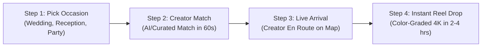

# Reeload — UI/UX Design & High-End Animation Blueprint

## 1. Executive Vision & Benchmark Research
**Product:** Reeload — Bengaluru's 1st on-demand Reel-Maker booking platform.
**Aesthetic Standard:** Luxury editorial mixed with high-tech consumer mobility (benchmarks: *Apple Product Tour, Airbnb Experiences, Lusion.co, Linear, Arc by The Browser Company*).
**Brand DNA:** 
- Palette: Noir/Crimson Velvet (`#100507`, `#25090d`, `#ff4c70`, `#d89b67`).
- Tone: Premium, fast, effortless, social-first.
- Emotional Hook: *"Your moments happen once. We turn them into cinematic reels before the night is over."*

---

## 2. Benchmark Case Studies & Animation Patterns

| Industry Benchmark | Design/Animation Pattern | How Reeload Adopts It |
| :--- | :--- | :--- |
| **Apple Product Showcases** | Sticky scroll storytelling + 3D device tilt & interactive hardware layer | Hero dual-phone 3D perspective with realistic glass reflections and live cursor-driven gyro tilt. |
| **Uber / Blinkit Real-Time Mobility** | SVG path morphing, animated radar pins & status progression | The interactive booking simulator: animated creator route on map moving to the event venue in Indiranagar/Koramangala. |
| **Linear / Vercel** | Bento-grid glow cards, magnetic buttons, noise shaders & silky 60fps transitions | Pricing cards with dynamic gradient border beam, fluid tab toggles, and rolling number tickers. |
| **Instagram / TikTok Reels** | Fluid 9:16 vertical cards with instant autoplay, sound toggle, tactile swipe | Portfolio carousel with hover-to-preview, sound pulse ripple, and instant fullscreen reel modal. |

---

## 3. Core Architecture: The 4-Step Interactive Booking Simulator
Instead of a static mockup or wall of text, the user experiences the **Reeload Booking Flow** right on the page through a **Scroll-Pinned Interactive Simulator**:

### Detailed Screen Choreography:
1. **State 1 — Event & Package Selection:**
   - Tap micro-interaction on event pills ("Wedding", "Half Day", "Reeload Select").
   - Phone screen smoothly cross-fades package details with spring physics.
2. **State 2 — Creator Matched:**
   - Creator profile badge pops with photo, gear tag (`iPhone 17 Pro + DJI Gimbal`), and rating (`★ 4.9 · 180+ reels`).
3. **State 3 — Real-Time En Route:**
   - Vector map renders Bangalore street lines; glowing blue polyline draws dynamically from Koramangala to the venue pin.
   - Status badge transitions: `"Arriving in 14 mins"`.
4. **State 4 — The Reel Drop:**
   - Notification toast sweeps down: *"Your Wedding Highlights Reel is ready to post"*.
   - A playable 9:16 vertical reel preview animates into center focus.

---

## 4. Section-by-Section Animation Choreography

### 1. Navigation Header
- **Floating Island Pill:** Subtle frosted glass backdrop (`backdrop-filter: blur(20px)`), center-aligned.
- **Scroll Intelligence:** Collapses slightly on scroll down; expands smoothly on scroll up.
- **Magnetic Links:** Cursor magnetism on hover with smooth underline or soft capsule pill glow indicator.

### 2. Hero Section
- **Staggered Orchestrated Entry:**
  1. `0.0s`: Deep velvet radial glow breathing animation begins.
  2. `0.2s`: Eyebrow kicker fades and slides up.
  3. `0.4s`: Main title `"REEL-MAKER"` reveals with gradient iridescent shine animation.
  4. `0.6s`: Live indicator dot pulses with dual radar rings.
  5. `0.8s`: CTAs slide up with subtle spring bounce.
  6. `1.0s`: 3D Phone stage floats in with perspective depth.
- **Interactive Device Stage:**
  - Cursor tracking tilt (`perspective: 1400px`, `rotateX`, `rotateY`).
  - Screen ambient reflections tracking pointer motion.

### 3. Reel Gallery & Curated Portfolio
- **Curved Continuous Marquee:**
  - Infinitely scrolling multi-tilt card track (alternating $\pm 5^\circ$ angles).
  - Hover deceleration: Smoothly slows down on hover without abrupt halting.
  - Card expansion: Hovered card un-tilts, lifts (`translateY(-12px)`), scale `1.03`, and triggers video preview.
  - Lightbox modal: Full 9:16 vertical player with sound toggle, likes, share counter, and creator badge.

### 4. Packages & Dynamic Pricing
- **Fluid Morphing Tab:**
  - Sliding capsule indicator under active tab (no harsh layout jumps).
- **Rolling Price Ticker:**
  - Currency digits count up from ₹0 to target value with exponential easing (`₹2,499`, `₹6,249`, `₹19,999`).
- **Featured Card Beam:**
  - Subtle rotating border beam (`conic-gradient`) on the "Half Day" and "Reeload Select" cards.

### 5. Process Roadmap (01 to 05)
- **Active Progress Line:**
  - A glowing vertical/horizontal connector SVG path that illuminates as the user scrolls past each milestone step.
  - Step numbers count in with subtle badge glow.

### 6. Social Proof / Marquee Reviews
- **Double-Buffered Infinite Marquee:**
  - Smooth 60fps velocity-based scrolling with pause-on-hover.
  - Frosted glass cards with glassmorphism border highlight.

### 7. Instant Booking Form
- **Micro-Delights:**
  - Floating label transitions.
  - Date picker with custom dark theme integration.
  - Submit button with state morphing: *Book Reel Maker* $\rightarrow$ *Matching Creator...* $\rightarrow$ *✓ Request Confirmed*.

---

## 5. Technical Implementation Stack
- **Scroll Engine:** **Lenis** (ultra-lightweight buttery smooth scrolling, prevents jank).
- **Animation Orchestration:** **GSAP + ScrollTrigger** (for scrubbed phone animations and pinning) or **Zero-dependency CSS Scroll-Driven Animations** with `requestAnimationFrame` lerping.
- **Asset Optimization:** WebP/AVIF imagery, compressed muted WebM/MP4 video loops for low bandwidth mobile usage.
